# 🏢 Awesome Enterprise Resource Planning (ERP)

### 🚀 Curated Directory of Enterprise SaaS Solutions & Top Open-Source ERP Frameworks

  
  
  
  
  
  
  
  

**A battle-tested reference for operations executives, software architects, IT managers, and developers building scalable business management systems.**

*Explore market dynamics, starting tier pricing, free trial terms, company valuations, and self-hosted open-source GitHub repositories.*

---

## 📑 Table of Contents

- [🌐 Sector Overview & Market Dynamics](#-sector-overview--market-dynamics)
- [☁️ Enterprise SaaS & Cloud ERP Platforms](#️-enterprise-saas--cloud-erp-platforms)
- [🔓 Top Open-Source ERP GitHub Projects](#-top-open-source-erp-github-projects)
- [🧭 Decision & Architecture Matrix](#-decision--architecture-matrix)
- [🤝 How to Contribute](#-how-to-contribute)
- [💖 Support & Sponsor](#-support--sponsor)
- [Star History](#star-history)
- [⚖️ Disclaimer & Governance](#️-disclaimer--governance)

---

## 🌐 Sector Overview & Market Dynamics

The global **Enterprise Resource Planning (ERP)** software market represents one of the largest foundational pillars of enterprise IT infrastructure. 

- **📈 Market Size & Growth Trajectory:** The global ERP market was valued at **$60.5 Billion in 2024** and is projected to reach **$105.8 Billion by 2030**, expanding at a Compound Annual Growth Rate (**CAGR of 9.8% to 11.2%**). Growth is propelled by enterprise-wide cloud migrations, legacy modernization, composable application architectures, automated accounting pipelines, and embedded generative AI co-pilots for predictive procurement and demand planning.
- **🏛️ Market Dynamics & Fragmentation:** The sector displays a **two-tier market structure**:
  - **Upper-Tier Concentration:** The Tier-1 enterprise tier is **moderately concentrated**, dominated by multi-billion dollar mega-vendors (Microsoft, Oracle, SAP, Workday) commanding over **52% of total enterprise spend**, driven by high switching costs, multi-year implementation commitments, and deeply embedded global compliance engines.
  - **Mid-Market & Open-Source Fragmentation:** Conversely, the mid-market, SMB, and specialized vertical tiers remain **highly fragmented**. High SaaS subscription fees and proprietary vendor lock-in have created immense demand for modular, vertical-specific suites (Epicor, Sage, Acumatica) and sovereign, **self-hosted open-source ERP systems** (Odoo, ERPNext, Dolibarr) that eliminate per-seat licensing penalties while providing complete data sovereignty.

---

## ☁️ Enterprise SaaS & Cloud ERP Platforms

Below is the verified breakdown of leading commercial SaaS ERP platforms. The table is **sorted descending by Company Size** (Market Capitalization or Enterprise Valuation / Annual Revenue).

| 🏢 Platform / Vendor | 🎯 Core Focus & Key Modules | 📊 Company Size (Market Cap / Valuation / Rev) | 💳 Starting Tier Pricing | 🎁 Free Tier / Free Trial Limit |
| :--- | :--- | :--- | :--- | :--- |
| **[Microsoft Dynamics 365](https://www.microsoft.com/en-us/dynamics-365)** | Unified ERP + CRM; Finance, Supply Chain Management, Commerce, HR, and Business Central for SMBs. Azure & M365 native. | **~$3.1 Trillion** Market Cap *(~$245B Annual Revenue)* | **$70 / user / month** *(Business Central Essentials)* | **30-Day Free Trial** *(Full feature access, guided sample company data, no credit card required)* |
| **[Oracle Fusion Cloud ERP](https://www.oracle.com/erp/)** | Global Tier-1 financial management, procurement, project portfolio management (PPM), enterprise risk management (EPM), AI analytics. | **~$450 Billion** Market Cap *(~$53B Annual Revenue)* | **$625 / user / month** *(Oracle Financials Cloud, min. 10 users = $6,250/mo)* | **30-Day Guided Cloud Trial** *(Access via Oracle Cloud Free Tier with $300 cloud credits + guided demo sandbox)* |
| **[SAP S/4HANA Cloud](https://www.sap.com/products/erp/s4hana.html)** | Flagship in-memory intelligent ERP suite; real-time MRP, global supply chain execution, finance, manufacturing, multi-national tax compliance. | **~$260 Billion** Market Cap *(~$34B / €31B Annual Revenue)* | **~$117 / user / month** *(S/4HANA Cloud Public Edition; entry packages start ~$3,500/mo billed annually)* | **14-Day Free Trial** *(Interactive public cloud sandbox environment with pre-loaded business master data)* |
| **[Workday](https://www.workday.com/)** | Cloud-native Human Capital Management (HCM), Financial Management, spend analysis, corporate planning, workforce analytics. | **~$70 Billion** Market Cap *(~$7.3B Annual Revenue)* | **~$100 / user / month** *(HCM/Financials baseline; typical annual enterprise contracts start at ~$45,000/yr)* | **No Free Tier** *(Interactive guided test-drive tours & custom POC sandbox upon enterprise sales qualification)* |
| **[NetSuite](https://www.netsuite.com/)** | Mid-market and scaling enterprise cloud ERP; general ledger, multi-currency (OneWorld), CRM, inventory, PSA, and commerce. | **~$30+ Billion** Valuation *(Oracle unit)* *(Parent $450B; ~$2B+ dedicated ARR)* | **$999 / month** base license + **$99 / user / month** | **No Free Tier** *(14-day interactive guided product tour and tailored sandbox trial through sales consult)* |
| **[Sage X3](https://www.sage.com/en-us/products/sage-x3/)** | Mid-market manufacturing, discrete & process production, wholesale distribution, supply chain, and international multi-legislation finance. | **~$15 Billion** Market Cap *(~$2.8B / £2.2B Annual Revenue)* | **~$120 / user / month** *(Plus system core platform subscription from ~$1,500/mo)* | **30-Day Guided Sandbox Trial** *(Available upon discovery qualification with Sage authorization partners)* |
| **[Infor CloudSuite](https://www.infor.com/products/cloudsuite)** | Deep industry-vertical ERP (Industrial, Distribution, Food & Beverage, Healthcare) powered by Infor OS and Coleman AI on AWS. | **~$13 Billion** Enterprise Valuation *(Koch Industries; ~$3.5B Annual Rev)* | **~$150 / user / month** *(Industry CloudSuite standard edition entry tier)* | **No Free Tier** *(Live interactive sandbox demo environment customized per vertical workflow on request)* |
| **[Epicor ERP](https://www.epicor.com/)** *(Kinetic)* | Built specifically for make-to-order (MTO), engineer-to-order (ETO) manufacturing, precision fabrication, aerospace, and distribution. | **~$4.7 Billion** Private Valuation *(CD&R; ~$1.0B Annual Revenue)* | **~$175 / user / month** *(Kinetic Cloud entry manufacturing package)* | **No Free Tier** *(Personalized test-drive virtual environment scheduled with Epicor manufacturing specialists)* |
| **[Odoo Enterprise](https://www.odoo.com/)** | Commercial managed edition of Odoo; full accounting localization, native mobile apps, automated studio no-code editor, cloud hosting. | **~$3.5 Billion** Valuation *(€3.2B valuation; ~$350M+ ARR)* | **$24.90 / user / month** *(Standard Plan - all 80+ apps included, billed annually)* | **Free Forever (1 App)** *(Unlimited users for single app on Odoo Online) or **15-Day Free Trial** (all apps, unlimited)* |
| **[Acumatica](https://www.acumatica.com/)** | Cloud ERP featuring consumption-based pricing (no per-seat penalties); general business, manufacturing, construction, distribution. | **~$2.0 Billion** Private Valuation *(EQT Partners; ~$150M+ ARR)* | **~$1,000 / month** base tier *(Resource/transaction-based pricing; unlimited users)* | **14-Day Free Test Drive** *(Full cloud sandbox preview access with sample industry workflows)* |
| **[Unit4](https://www.unit4.com/)** | People-centric ERPx designed for professional services, non-profits, higher education, and public sector project accounting. | **~$2.0 Billion** Acquisition Valuation *(TA Associates; ~$400M Annual Rev)* | **~$140 / user / month** *(ERPx core service enterprise package)* | **No Free Tier** *(Guided POC simulation and interactive prototype access arranged with solution engineers)* |

---

## 🔓 Top Open-Source ERP GitHub Projects

Self-hosted and open-source ERP systems offer complete architectural sovereignty, eliminate license bloat, and grant full source code access.

The list below is **sorted descending by GitHub Stars_Count**. Beside each project, click the Stars_Badge to visit its official GitHub stargazers page.

---

### 1. 🌟 [Odoo Community](https://github.com/odoo/odoo)

- **Description:** The world's most widely adopted open-source business application ecosystem. Features a modular architecture covering CRM, sales pipeline, purchase orders, inventory, manufacturing (MRP), and basic invoicing with tens of thousands of community modules.
- **Tech Stack:** Python, JavaScript, PostgreSQL, XML-RPC / JSON-RPC.
- **License:** LGPL-3.0.
- **Ideal For:** Small-to-midsize businesses seeking comprehensive out-of-the-box functional breadth and a thriving community app store.

---

### 2. 🌟 [ERPNext](https://github.com/frappe/erpnext)

- **Description:** A modern, full-featured open-source ERP platform built on top of the Frappe Framework. Out of the box it provides full double-entry accounting, inventory & warehouse control, manufacturing, human resources, CRM, payroll, asset management, and project tracking.
- **Tech Stack:** Python, Frappe Framework, JavaScript, MariaDB / PostgreSQL, Redis.
- **License:** GPL-3.0.
- **Ideal For:** Growing companies and tech-forward teams wanting an unbundled, 100% free open-source alternative to SAP and NetSuite.

---

### 3. 🌟 [NocoBase](https://github.com/nocobase/nocobase)

- **Description:** Extensible open-source no-code platform specifically engineered for constructing customized internal ERPs, CRMs, and operations portals without writing boilerplate glue code.
- **Tech Stack:** Node.js, TypeScript, React, Koa, Sequelize (PostgreSQL, MySQL, SQLite).
- **License:** AGPL-3.0 / Commercial.
- **Ideal For:** Internal tools teams needing custom data models, workflow orchestrations, and granular role permissions.

---

### 4. 🌟 [Aureus ERP](https://github.com/aureuserp/aureuserp)

- **Description:** High-performance, plugin-driven open-source enterprise management platform featuring integrated customer relationships, inventory synchronization, invoicing, and production orders.
- **Tech Stack:** PHP, Laravel, Vue.js, MySQL.
- **License:** Open Source.
- **Ideal For:** Teams looking for a lightweight, modular PHP/Laravel foundation for modern business operations.

---

### 5. 🌟 [Akaunting](https://github.com/akaunting/akaunting)

- **Description:** Free, open-source accounting and lightweight ERP software designed for small businesses and freelancers. Covers invoicing, expense tracking, multi-currency reporting, banking feeds, and inventory management.
- **Tech Stack:** PHP, Laravel, Tailwind CSS, Vue.js, MySQL.
- **License:** GPL-3.0.
- **Ideal For:** Small businesses that need robust bookkeeping, invoice workflows, and client billing without enterprise complexity.

---

### 6. 🌟 [IDURAR ERP & CRM](https://github.com/idurar/idurar-erp-crm)

- **Description:** Modern open-source ERP/CRM application tailored for invoicing, customer management, inventory, and accounting built using a modern JavaScript/TypeScript full-stack architecture.
- **Tech Stack:** Node.js, Express.js, React.js, Ant Design, MongoDB.
- **License:** MIT / Open Source.
- **Ideal For:** Startups and development teams comfortable with the MERN stack seeking a customizable, contemporary interface.

---

### 7. 🌟 [Ever Gauzy](https://github.com/ever-co/ever-gauzy)

- **Description:** Open-source business management and operations suite unifying ERP, CRM, HRM, time-tracking, applicant tracking (ATS), project management, and financial accounting.
- **Tech Stack:** TypeScript, NestJS, Angular, TypeORM, PostgreSQL.
- **License:** AGPL-3.0 / Apache-2.0.
- **Ideal For:** Remote companies, digital agencies, and service organizations requiring integrated operational analytics.

---

### 8. 🌟 [Dolibarr ERP & CRM](https://github.com/Dolibarr/dolibarr)

- **Description:** Battle-hardened web-based suite for SMBs, foundations, and freelancers. Features plug-and-play modules for quotes, commercial proposals, inventory, point of sale (POS), orders, agenda, and bank reconciliation.
- **Tech Stack:** PHP, JavaScript, MariaDB / MySQL / PostgreSQL.
- **License:** GPL-3.0.
- **Ideal For:** Small enterprises and non-profits seeking an ultra-reliable, zero-dependency PHP ERP deployable on shared hosting.

---

### 9. 🌟 [jshERP (华夏ERP)](https://github.com/jishenghua/jshERP)

- **Description:** Highly focused open-source ERP system covering inventory management (purchase, sales, stock transfer), assembly/disassembly, retail workflows, and basic enterprise financial reporting.
- **Tech Stack:** Java, Spring Boot, Vue.js, Element-UI, MySQL, Redis.
- **License:** GPL-3.0.
- **Ideal For:** Retailers, wholesalers, and e-commerce distribution businesses needing rock-solid inventory control.

---

### 10. 🌟 [Carbon](https://github.com/crbnos/carbon)

- **Description:** Next-generation open-source manufacturing ERP, MES (Manufacturing Execution System), and QMS (Quality Management System). Unifies quoting, BOMs, MRP, shop floor scheduling, lot/serial traceability, REST API, and built-in MCP server for AI integration.
- **Tech Stack:** TypeScript, Remix / React, PostgreSQL, Prisma, Docker.
- **License:** AGPL-3.0.
- **Ideal For:** Modern hardware manufacturers and machine shops demanding real-time shop floor execution and AI-assisted workflows.

---

### 11. 🌟 [metasfresh](https://github.com/metasfresh/metasfresh)

- **Description:** Enterprise-class open-source ERP built for high-volume wholesale distribution, logistics, agricultural supply chains, and complex warehousing. Features EDI standard interfaces, picking wave management, and automated shipping workflows.
- **Tech Stack:** Java, Spring Boot, React, PostgreSQL, Docker / Kubernetes.
- **License:** GPL-2.0 / GPL-3.0.
- **Ideal For:** Distributors, logistics operators, and mid-sized industrial supply companies handling hundreds of thousands of line items.

---

### 12. 🌟 [Apache OFBiz](https://github.com/apache/ofbiz-framework)

- **Description:** Apache Foundation top-level enterprise business application suite and Java framework. Provides universal data models and service-oriented business logic spanning accounting, warehouse automation, manufacturing MRP, and B2B/B2C e-commerce.
- **Tech Stack:** Java, Groovy, Apache Tomcat, Gradle, Multi-database abstraction.
- **License:** Apache-2.0.
- **Ideal For:** Large enterprises and systems integrators seeking an unencumbered Apache-licensed foundation to build custom solutions.

---

### 13. 🌟 [Axelor Open Suite](https://github.com/axelor/axelor-open-suite)

- **Description:** Hybrid low-code platform and full-featured business suite featuring 30+ integrated apps: ERP, CRM, HR, inventory, project accounting, and visual BPM (Business Process Model and Notation) workflow engine.
- **Tech Stack:** Java, Spring, React / AngularJS, PostgreSQL.
- **License:** AGPL-3.0.
- **Ideal For:** Organizations seeking a combined visual workflow orchestrator (BPMN) and modular enterprise ERP suite.

---

### 14. 🌟 [ADempiere](https://github.com/adempiere/adempiere)

- **Description:** Mature community-driven enterprise fork of Compiere with robust support for internationalization, multi-currency balance sheets, supply chain orchestration, and point of sale.
- **Tech Stack:** Java, ZK Framework, PostgreSQL / Oracle.
- **License:** GPL-2.0.
- **Ideal For:** Cross-border enterprises requiring strict financial audit trails and complex international tax structures.

---

### 15. 🌟 [iDempiere](https://github.com/idempiere/idempiere)

- **Description:** Award-winning OSGi-based modular evolution of ADempiere and Compiere ("OSGi + ADempiere"). Offers an extensible plug-in architecture for ERP, CRM, MRP, and accounting.
- **Tech Stack:** Java, OSGi, Apache Felix, ZK 9, PostgreSQL.
- **License:** GPL-2.0.
- **Ideal For:** Java engineers who require plug-in isolation, modular upgrade paths, and deep multi-organization capabilities.

---

### 16. 🌟 [LedgerSMB](https://github.com/ledgersmb/LedgerSMB)

- **Description:** Reliable double-entry accounting and ERP package prioritizing database-level transactional integrity. Handles quotation, order management, AR/AP, inventory tracking, and VAT/tax reporting directly in PostgreSQL.
- **Tech Stack:** Perl, PostgreSQL (server-side stored procedures), JavaScript.
- **License:** GPL-2.0.
- **Ideal For:** Accountants, financial auditors, and businesses requiring strict ACID-compliant database enforcement for journals.

---

### 17. 🌟 [Moqui Framework & Mantle](https://github.com/moqui/moqui-framework)

- **Description:** An enterprise-grade transactional application ecosystem created by the original designer of Apache OFBiz. Features the Mantle Universal Data Model (UDM) and Universal Service Library (USL) for building ERP, CRM, and SCM systems.
- **Tech Stack:** Java, Groovy, Elasticsearch / OpenSearch, PostgreSQL / MySQL.
- **License:** CC0 1.0 (Public Domain / Apache compatible).
- **Ideal For:** Technical architects seeking a flexible enterprise framework without legacy baggage.

---

### 18. 🌟 [Tryton](https://github.com/tryton/tryton)

- **Description:** Modular three-tier enterprise framework written purely in Python. Known for clean code architecture, strict database integrity, rock-solid security releases, and granular modules for production routing and MRP.
- **Tech Stack:** Python, PostgreSQL, GTK / Web client.
- **License:** GPL-3.0.
- **Ideal For:** Python-focused teams and precision manufacturers demanding API stability and long-term LTS releases.

---

### 19. 🌟 [BlueSeer ERP](https://github.com/blueseerERP/blueseer)

- **Description:** Free desktop-and-server ERP and EDI package built specifically for small-to-medium discrete and batch manufacturing shops. Features embedded Electronic Data Interchange (EDI X12/EDIFACT) translation.
- **Tech Stack:** Java, Swing, MySQL / SQLite.
- **License:** MIT License.
- **Ideal For:** Automotive and industrial suppliers needing native EDI integration and quick job order tracking.

---

### 20. 🌟 [OpenXE](https://github.com/OpenXE-org/OpenXE)

- **Description:** Independent open-source fork and continuation of the open-source Xentral ERP codebase, focusing on order processing, multi-channel e-commerce syncing, inventory management, and shipping fulfillment.
- **Tech Stack:** PHP, MySQL, JavaScript.
- **License:** GPL-3.0.
- **Ideal For:** E-commerce merchants looking for warehouse fulfillment and marketplace connectors.

---

### 21. 🌟 [uzERP](https://github.com/uzerpllp/uzerp)

- **Description:** Comprehensive open-source business management system covering manufacturing bills of materials (BOM), purchasing, stock control, sales orders, and financial ledgers.
- **Tech Stack:** PHP, PostgreSQL, Apache.
- **License:** GPL-3.0.
- **Ideal For:** Discrete manufacturers requiring straightforward bill of materials, work orders, and shop-floor tracking.

---

## 🧭 Decision & Architecture Matrix

| Requirement / Archetype | Top Recommended Solution | Key Selection Rationale |
| :--- | :--- | :--- |
| **Global Fortune 500 Enterprise** | **SAP S/4HANA / Oracle Fusion Cloud** | Deepest regulatory compliance, global localization, in-memory transaction performance. |
| **Mid-Market Fast-Growing SaaS / Tech** | **NetSuite / Dynamics 365 Business Central** | Standardized GL, multi-subsidiary rollup, swift cloud implementation, tight CRM ties. |
| **Full-Suite Open-Source Alternative** | **ERPNext (Frappe)** | 100% open-source, built-in double-entry accounting, modern REST API, zero per-seat fees. |
| **Extensive Module Ecosystem & App Store** | **Odoo Community / Enterprise** | 80+ official apps and over 35,000 community modules for custom operational workflows. |
| **High-Volume Distribution & Logistics** | **metasfresh** | Engineered for rapid order processing, picking waves, shipping labels, and automated EDI. |
| **Modern Machine Shops & Manufacturing** | **Carbon / BlueSeer** | Shop floor MES, lot/serial traceability, BOM routing, built-in EDI, and AI agent integration. |
| **Service Organizations & Project Work** | **Unit4 ERPx / Ever Gauzy** | People-centric workflows, project billing, timesheet automation, and resource scheduling. |

---

## 🤝 How to Contribute

Contributions are warmly welcomed! Help keep this enterprise directory accurate, fresh, and valuable for the open-source and operations community.

1. **Fork the Repository** on GitHub.
2. **Create a Topic Branch**: `git checkout -b feature/add-new-erp-system`
3. **Add or Update Entries**:
   - For **SaaS platforms**, ensure starting tier pricing, free trial specifications, and company valuation data are accurate and cited.
   - For **Open-Source projects**, verify the GitHub Stars_Count, correct repo link, and appropriate social Stars_Badge.
4. **Submit a Pull Request**: Include a brief overview of changes and source links for pricing or repository details.

---

## 💖 Support & Sponsor

Thank you for exploring and utilizing this curated enterprise resource planning guide! Building and maintaining comprehensive open-source research takes dedication and time.

If this repository helped you in your architectural evaluation, enterprise software selection, or open-source research, please consider supporting the project:

- ⭐ **Star this repository** on GitHub to increase its visibility for the developer community.
- 🍴 **Fork and share** it with your engineering team, operations peers, and social networks.
- ☕ **Buy me a coffee / Sponsor the project:** Support ongoing updates and maintenance directly via the [GitHub Sponsors Dashboard](https://github.com/sponsors/ishandutta2007).

  

---

##  Star History

---

## ⚖️ Disclaimer & Governance

- This repository is a **community-curated index** created for educational, architectural, and operational research purposes. Mention of commercial vendors does not constitute an endorsement.
- All product names, logos, trademarks, and registered trademarks are the property of their respective owners.
- While open-source ERP systems eliminate software license costs, self-hosted deployments require ongoing IT governance, backup verification, database optimization, and security audits.

---

**Built with ❤️ for operations leaders, IT administrators, solutions architects, and sovereign enterprise builders.**

[⭐ Star on GitHub](https://github.com/ishandutta2007/Awesome-Enterprise-Resource-Planning-ERP) • [🐛 Report Issue](https://github.com/ishandutta2007/Awesome-Enterprise-Resource-Planning-ERP/issues) • [💬 Join Discord](https://discord.gg/jc4xtF58Ve)

